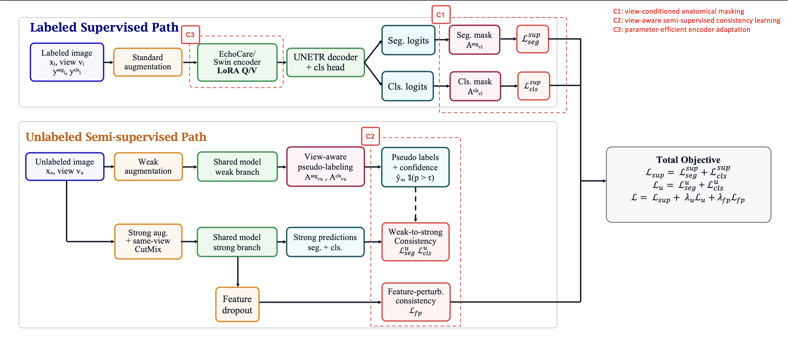

# VAST
### 胎儿心脏超声的视图感知半监督多任务学习框架

**Qiujin Wang · Wenzheng Huang · Jiachen Yuan · Zhenzhong Chen · Silvia Spinato · Netzahualcoyotl Hernandez-Cruz**

[English](README.md) | [简体中文](README_zh-CN.md)  
[方法](#方法) · [复现流程](#复现流程) · [仓库结构](#仓库结构) · [引用](#引用)

## 论文信息

论文题目为 *View-Aware Semi-Supervised Multi-Task Learning Framework for Fetal
Cardiac Ultrasound*。当前引用采用待更新出版信息的 manuscript 条目；正式发表信息确认后，
再补充期刊、年份和 DOI。引用文件见 [BibTeX](citations/VAST.bib) 和 [CITATION.cff](CITATION.cff)。

## 方法

胎儿心脏的不同标准切面包含不同解剖结构。同一分割类别或分类标签，在一个切面中可能有效，
在另一个切面中则不适用。VAST 利用采集时已知的切面信息，在共享网络中联合完成分割与多标签分类。



**图 1．论文中的 VAST 框架示意图。** 代码中各分支的具体实现见“数据、权重与实现范围”。

三个主要组件为：

- **C1：视图条件解剖掩码。** 用切面对应的有效类别约束分割 logits 和分类损失。
- **C2：视图感知半监督一致性。** 从弱增强预测生成经置信度筛选的伪标签，监督强增强、
  same-view CutMix 和特征扰动分支。
- **C3：参数高效编码器适配。** 冻结原始 Swin 编码器，在 query/value 投影上训练 LoRA，
  并训练 UNETR 分割解码器及分类头。

网络输出包含背景的 15 类分割 logits，以及七维分类 logits。分类头使用瓶颈池化特征。
各路径共享网络参数，代码没有额外的 EMA teacher。

| 阶段 | 半监督一致性 | 训练时视图掩码 | LoRA | same-view CutMix | 特征扰动 |
|---|---|---|---|---|---|
| 0：监督基线 | 否 | 否 | 否 | 否 | 否 |
| 1：+ SSL | 是 | 否 | 否 | 否 | 否 |
| 2：+ view masking | 是 | 是 | 否 | 否 | 否 |
| 3：+ LoRA | 是 | 是 | 是 | 否 | 否 |
| 4：完整 VAST | 是 | 是 | 是 | 是 | 是 |

最后一步同时加入 CutMix 与 feature perturbation。各阶段验证时均使用相同的已知视图约束，
因而视图掩码消融改变的是训练时的使用方式。

## 复现流程

### 1. 安装环境

建议使用 Python 3.10、Linux 与兼容的 NVIDIA 环境。依赖文件指定 PyTorch 2.5.1、
torchvision 0.20.1、MONAI 1.4.0 及 CUDA 12.1 wheel 源。

```bash
conda create -n vast python=3.10 -y
conda activate vast
python -m pip install -r requirements.txt
cp configs/paths.example.sh configs/paths.sh
```

在 `configs/paths.sh` 中设置 `PROJECT_ROOT`。默认是被 Git 忽略的 `private_workspace/`。
`PYTHON_BIN` 指定解释器，`VAST_DEVICE` 默认 `cuda:0`；批处理需要激活 Conda 时，
可设置 `CONDA_SH` 和 `CONDA_ENV`。应在实际训练环境中执行 prepare；环境或源码改变后需重新准备新协议。

### 2. 准备本地数据和编码器

从原始提供方取得授权的 FETUS 数据与兼容编码器，自行建立本地划分清单：

```text
PROJECT_ROOT/
├── data/
│   ├── train_labeled.json
│   ├── train_unlabeled.json
│   ├── valid.json
│   ├── images/
│   └── labels/
└── pretrained_weights/
    └── echocare_encoder.pth
```

三个 JSON 都是记录列表。每条记录的 `image` 为相对 `PROJECT_ROOT`、以 `data/` 开头的
图像 HDF5 路径；有标注和验证记录还需要 `label` 指向对应目标 HDF5。无标注记录只需 `image`。
仓库不提供真实记录或原始划分。

| 文件 | 内容 |
|---|---|
| 图像 HDF5 | `image`：H×W×3 RGB 数组；`view`：形状 (1,) 的整数数组，1=4CH、2=LVOT、3=RVOT、4=3VT |
| 目标 HDF5 | `mask`：与图像对齐的 H×W 整数掩码，类别 0–14；`label`：形状 (7,) 的二元分类向量 |

数字类别的解剖含义与编码器结构必须匹配原任务。若需要患者或扫描级独立划分，
必须使用原始元数据建立；图像 ID 无交集不能证明患者独立。

```bash
bash scripts/01_prepare.sh
```

该步骤检查路径、掩码尺寸及样本重叠，在本地记录源码、划分顺序、环境和编码器信息。
本仓库未发布原始私有划分和权重，因此不能仅凭仓库重建完全相同的实验样本集合。

### 3. Smoke 检查

```bash
bash scripts/02_smoke.sh
```

五个阶段各执行一次真实优化更新和验证，需要本地数据、权重及 GPU。
五个状态均为 `smoke_passed` 后，才运行正式训练。

### 4. 训练

```bash
# 完整 VAST 的单次训练
bash scripts/03_train.sh 4 42
```

若要执行五阶段、三个种子的完整比较，请使用新的输出目录，运行下面的循环，
不要重复提交已经存在的单次配置：

```bash
for stage in 0 1 2 3 4; do
  for seed in 42 123 2026; do
    bash scripts/03_train.sh "$stage" "$seed"
  done
done
```

协议使用 120 epochs、256×256 输入、batch size 8、AdamW、多项式学习率衰减、
bf16 AMP 和梯度裁剪。程序不会覆盖已有的 stage/seed 输出目录。

### 5. 重新评估 checkpoint

```bash
bash scripts/04_evaluate.sh VAST/runs/stage4_seed42/best.pth
```

独立命令行入口为：

```bash
python eval/evaluate.py \
  --checkpoint VAST/runs/stage4_seed42/best.pth \
  --project-root /path/to/private_workspace \
  --device cuda:0
```

该命令在原 prepared 内部验证集上重新评估已记录的最佳 checkpoint，需要同目录的
`manifest.json`，以及匹配的本地 `VAST/prepared/` 协议、源码和环境。
模型采用严格加载；默认将结果写入 checkpoint 旁新建的 `evaluation.json`，
也可通过 `--output` 指定新文件，不会覆盖已有输出。
输出还会比较本次指标与 checkpoint 中保存的参考值，保留有限差异并报告匹配标记。

分割指标为 Dice 和容差两像素的 NSD；分类使用阈值 0.5 下、视图有效位置上的 Macro-F1。
checkpoint 选择分数为 `(Dice% + NSD%)/2 + 100*Macro-F1`。
重新评估同一验证集不属于独立测试或外部验证。

### 6. 汇总自己的完整运行

```bash
bash scripts/05_aggregate.sh
```

汇总程序检查本地 checkpoint 与协议记录，输出各 seed 数值、阶段均值、样本标准差和相邻阶段增量。
缺失配置会标记为 incomplete，而不是用不足三个种子的结果计算阶段均值。

### Slurm

在仓库根目录激活环境、准备好输入后提交：

```bash
mkdir -p logs
sbatch --account=YOUR_ACCOUNT --partition=YOUR_PARTITION --qos=YOUR_QOS \
  --chdir="$PWD" --export=ALL train/slurm_smoke.sh
# 五个 smoke 通过后：
sbatch --account=YOUR_ACCOUNT --partition=YOUR_PARTITION --qos=YOUR_QOS \
  --chdir="$PWD" --export=ALL train/slurm_train.sh
```

模板不含特定学校账户、分区或 QOS，每个 task 使用一张 GPU。
数组索引为 `stage*3 + seed_index`，seed 顺序为 42、123、2026；
并发、内存和时限需按自己的集群设置。

## 仓库结构

```text
VAST/
├── assets/                  框架图
├── citations/               暂定论文 BibTeX
├── configs/                 本地路径模板
├── scripts/                 prepare、smoke、train、evaluate、aggregate
├── train/                   通用 Slurm 提交脚本
├── eval/                    独立 checkpoint 评估
├── VAST/                    五阶段训练与共享验证逻辑
│   └── runtime/             模型、数据加载、增强、损失与指标
├── tests/                   合成软件测试
├── CITATION.cff
├── requirements.txt
├── README.md
└── README_zh-CN.md
```

## 数据、权重与实现范围

仓库不分发数据集、真实划分、样本 ID、实验输出或训练权重。
这些内容由使用者按原始访问条款在本地取得；生成的协议、配置、运行目录、预测和结果均被 Git 忽略。

当前实现对有标注/弱分支特征进行扰动。强空间增强独立采样，弱分割伪标签未同步进行对应空间变换；
此训练行为予以保留。若改变方法，应建立新实验版本，而不是沿用原协议。

安装环境后，可运行合成软件测试，不需要研究数据：

```bash
python -m unittest discover -s tests -p "test_*.py"
```

## 引用

正式出版信息确认前，请使用以下暂定 manuscript 引用：

```bibtex
@unpublished{wangVAST,
  title  = {View-Aware Semi-Supervised Multi-Task Learning Framework for Fetal Cardiac Ultrasound},
  author = {Wang, Qiujin and Huang, Wenzheng and Yuan, Jiachen and Chen, Zhenzhong and Spinato, Silvia and Hernandez-Cruz, Netzahualcoyotl},
  note   = {Unpublished manuscript; publication details to be updated},
  url    = {https://github.com/Kelvin6657/VAST}
}
```

相同条目保存在 [citations/VAST.bib](citations/VAST.bib)，机器可读信息见 [CITATION.cff](CITATION.cff)。

## 致谢与许可证

本实现基于 FETUS baseline、EchoCare 风格的 SwinUNETR、MONAI 与 PyTorch，
感谢数据集及软件维护者。第三方依赖保留各自许可证；本仓库尚未指定统一的软件许可证。
